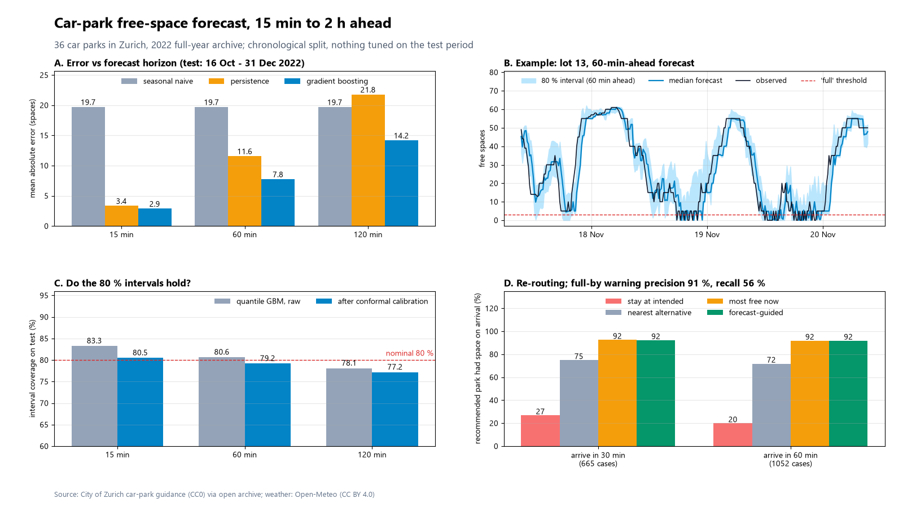
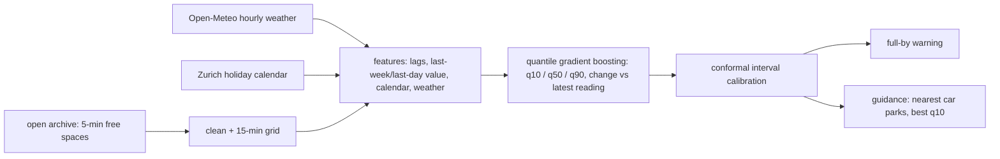

# parking-occupancy-forecast

Free-space forecasts for multi-storey car parks, 15 minutes to 2 hours ahead, with 80 % intervals, a "full by" warning and a re-routing suggestion. Trained and tested on a full year of open data from 36 car parks in Zurich.



## What it does

- **Forecast** free spaces per car park at 15, 30, 45, 60, 90 and 120 minutes ahead (median plus an 80 % interval).
- **"Full by" warning:** the earliest horizon at which the median forecast drops to the "full" level (at most 3 % of capacity, minimum 3 spaces).
- **Guidance:** if the car park you are heading for is forecast full on arrival, suggest the nearby car park (3 nearest with known coordinates) that has the most free spaces at its lower (10 %) forecast.
- **Baselines:** seasonal naive (same time one week earlier), persistence (latest reading) and a gradient-boosting model with calendar and weather features.
- Calendar features: Zurich public holidays (computed, not scraped), Saturdays, Sundays, holiday eve, local time of day. No event feed was found, so events are not a feature.

## Results

All numbers are measured by `python -m parking_forecast demo --ablations` on the **test period 16 Oct 2022 08:30 UTC to 31 Dec 2022 23:45 UTC** (about 11 weeks, 36 car parks, 15-minute grid). Training is 1 Jan to 1 Sep 2022, interval calibration is 1 Sep to 16 Oct 2022. Nothing was tuned on the test period. Raw values are in [`results/metrics.json`](results/metrics.json).

Mean absolute error in free spaces (lower is better):

| Horizon | Seasonal naive | Persistence | Gradient boosting | Gain vs seasonal naive |
|---|---|---|---|---|
| 15 min | 19.75 | 3.35 | **2.90** | 85 % |
| 60 min | 19.74 | 11.60 | **7.78** | 61 % |
| 120 min | 19.73 | 21.80 | **14.21** | 28 % |

Seasonal naive is a weak baseline on this data (its error does not depend on the horizon). Persistence is the fair one to beat at short range, and the model is only about 13 % better than it at 15 minutes.

80 % prediction interval (conformal calibration on the calibration weeks):

| Horizon | Coverage raw | Coverage calibrated | Mean width (spaces) |
|---|---|---|---|
| 15 min | 83.3 % | 80.5 % | 8.2 |
| 60 min | 80.6 % | 79.2 % | 19.7 |
| 120 min | 78.1 % | 77.2 % | 32.3 |

"Full" onset events in the test period: 1165 (a car park goes from more than 2 hours not-full to full). A warning is any horizon up to 120 min whose median forecast is at or below the full level.

| Warning source | Precision | Recall | Median lead time |
|---|---|---|---|
| Gradient boosting | 91 % (2000 warnings) | 56 % | 30 min (mean 47 min) |
| Seasonal naive | 49 % (13709 warnings) | 71 % | 120 min* |

Precision: share of warnings issued while not full that were followed by a full reading within 2 hours. Recall: share of onsets preceded by at least one warning in the 2 hours before. *The naive rule fires almost permanently, so its "lead time" is meaningless; it is shown to make the precision gap visible.

Guidance hit rate: cases are decision times where the intended car park still shows space but its median forecast on arrival is "full". A hit means the car park the method sends you to has more than the full level free on arrival.

| Arrival in | Cases | Stay at intended | Nearest alternative | Most free spaces now | Forecast-guided |
|---|---|---|---|---|---|
| 30 min | 665 | 27 % | 75 % | 92 % | 92 % |
| 60 min | 1052 | 20 % | 72 % | 92 % | 92 % |

The forecast-guided pick and the "most free spaces right now" pick land on the same hit rate. Within the three nearest alternatives, the forecast adds no measurable benefit over a live count at these horizons. What helps is having an alternative list and using the live counts.

Feature ablation (median model, MAE in spaces at 15 / 60 / 120 min):

| Variant | 15 min | 60 min | 120 min |
|---|---|---|---|
| All features | 2.91 | 7.79 | 14.24 |
| Without weather | 3.46 | 8.04 | 14.54 |
| Without calendar | 2.78 | 7.78 | 14.34 |

Weather helps at 15 minutes. The calendar features do not help in this setup, probably because one year contains only a handful of holidays to learn from.

## Quick start

```bash
uv venv .venv --python 3.12
uv pip install --python .venv/Scripts/python.exe -e ".[dev]"      # Linux/macOS: .venv/bin/python

python -m parking_forecast demo            # trains on the committed data, prints the tables, writes results/ and docs/
python -m parking_forecast demo --ablations  # also the weather/calendar ablation (about 10 min on a laptop CPU)
python -m parking_forecast demo --fast     # small smoke run
python -m parking_forecast fetch           # re-download the archive + weather into cache/ and rebuild data/
python -m parking_forecast collect         # poll the live feed every 5 min into cache/live_feed.csv
python -m pytest -q -p no:asyncio
```

The committed `data/` (1.7 MB: 15-minute free-space table, hourly weather, car-park anonymised coordinates) makes `demo` work offline.

## How it works



- **Cleaning:** negative values are dropped. Runs of exactly zero longer than 6 hours are treated as "no data" (closed or offline), not as full. Readings are forwarded at most 1 hour.
- **Capacity:** the feed carries no reliable capacity, so a proxy (99.5th percentile of free spaces in the training period) is used. Forecasts are made as a share of that proxy and converted back to spaces.
- **Model:** one `HistGradientBoostingRegressor` per quantile, shared across all car parks and horizons (horizon and car park are inputs). It predicts the change from the latest reading. Features use only information available at the forecast origin; tests check that changing future values does not change them.
- **Intervals:** the q10 and q90 outputs are widened or narrowed by split-conformal quantile regression (Romano et al. 2019) using the calibration weeks.
- **Weather** at the forecast origin is an input (observed, not a forecast).

## Data sources

- **Free spaces:** City of Zurich car-park guidance system, real-time feed `http://www.pls-zh.ch/plsFeed/rss`, listed on opendata.swiss and the city open data portal as "Parkleitsystem". **Licence: CC0 1.0** (the feed's own `copyright` field says its terms of use equal CC0, and the portal metadata says `cc-zero`). Commercial use is allowed and no attribution is required; credit is given here anyway.
- **History:** the feed only returns the current state. The open archive at https://parkendd.de/dumps/ (the city portal links to it as the public time series of this feed) stores one reading roughly every 5 minutes. This repo uses the 2022 files of the 36 car parks present in that year: 1 Jan to 31 Dec 2022, 35040 15-minute steps. The city portal text says these dumps may be downloaded and used without restriction; the archive itself does not publish a separate licence file.
- **Weather:** Open-Meteo Historical Weather API (hourly 2 m temperature and precipitation at 47.37 N, 8.54 E), licence CC BY 4.0. Attribution: weather data by Open-Meteo.com.
- **Coordinates:** taken from the archive's public metadata (street addresses and latitude/longitude); 5 of 36 car parks have none and are excluded from the guidance test. Car parks appear as `lot_01` to `lot_36`.
- **Live feed check:** `collect` was run against the live feed on 9 Nov 2026, 01:54 to 02:34 UTC (10 polls, 36 car parks each). That short sample only confirms the parser works on today's feed. It is not used for any number above.

## What is not verified yet

- **One year, one city.** Training, calibration and test are consecutive months of 2022; there is no second year or second city. Summer vs winter generalisation is untested (the test period is autumn/winter).
- **Not run on the live feed.** The live collector has only a short sample. The model has never been evaluated on current data, and the 2022 patterns may have shifted.
- **The archive is a third-party copy** of the city feed. Gaps and its recording method (reading timestamps, how zero is stored) are inferred from the data, not documented. The "no data" rule for long zero runs is an assumption.
- **Capacity is a proxy.** "Full" is defined relative to an estimated capacity. One car park's free count appears capped at 999.
- **Weather is observed at the forecast origin,** not a forecast, and no future weather is used. A real deployment would use a weather forecast and its errors are not modelled.
- **Events are not modelled.** No open event calendar was integrated, and the calendar features did not improve the error here.
- **Guidance is evaluated on counts, not on drivers.** A "hit" is space on arrival at the recommended car park, ignoring driving time, price, height limits, and drivers who react to the advice (which would change occupancy). Alternatives are the 3 nearest by straight-line distance.
- **The forecast adds nothing over a live count for guidance** in these results (see the table).
- **Full-by recall is 56 %.** Almost half of the full events within 2 hours are not announced in advance.
- **Interval coverage** drifts below 80 % at longer horizons on the test period (77 % at 120 min).
- **No hyper-parameter search;** the model settings were set once and not tuned.

## Licence

MIT, Copyright (c) 2026 Victor Bonilla. See [LICENSE](LICENSE). Data keeps its own licences (see above).
